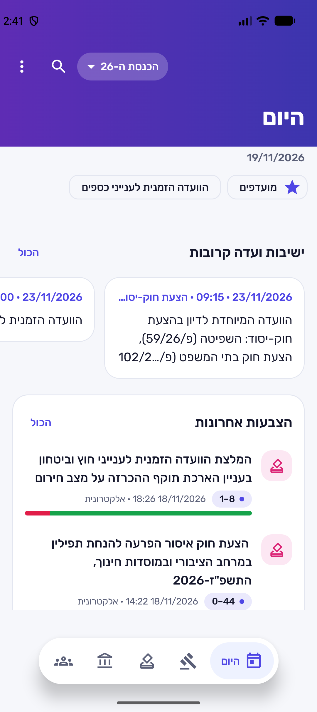
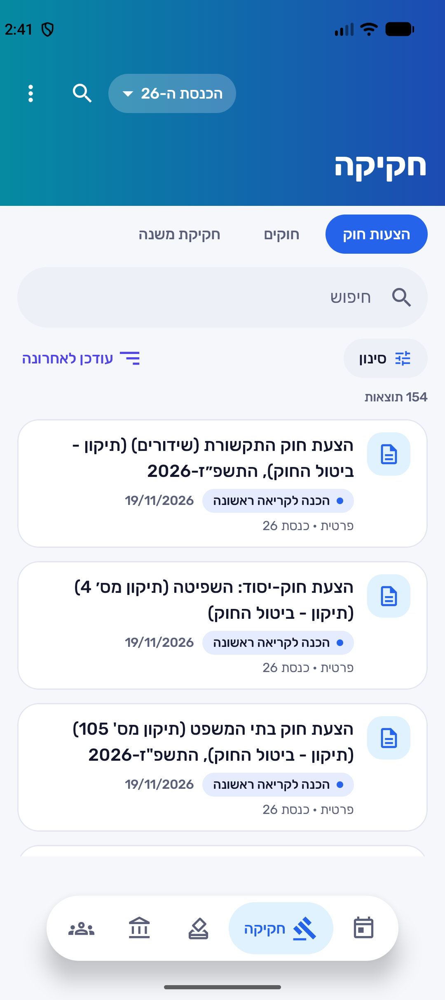
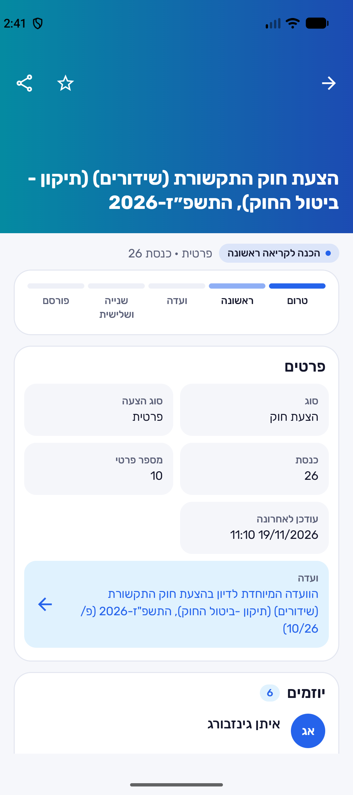
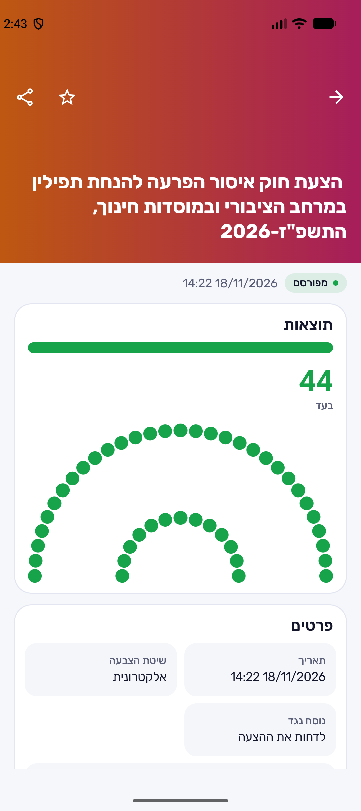
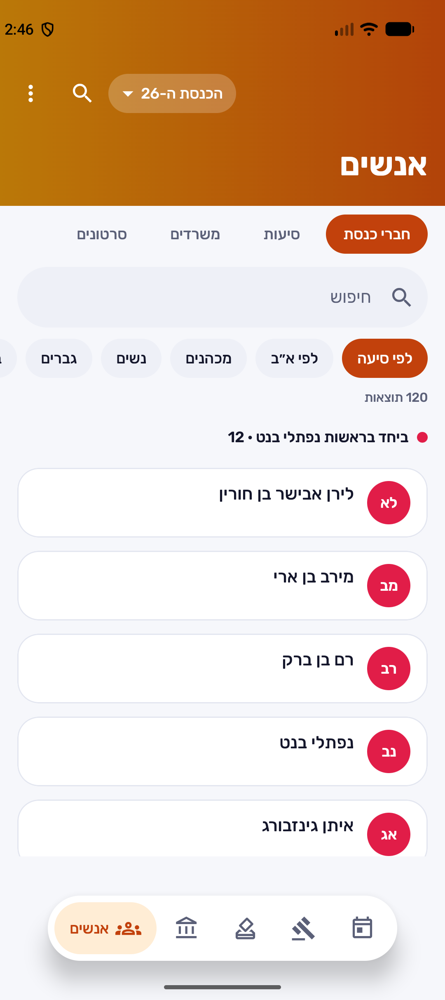
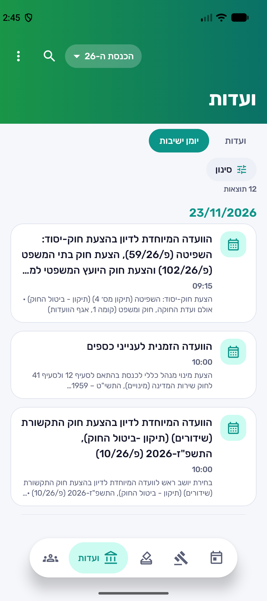
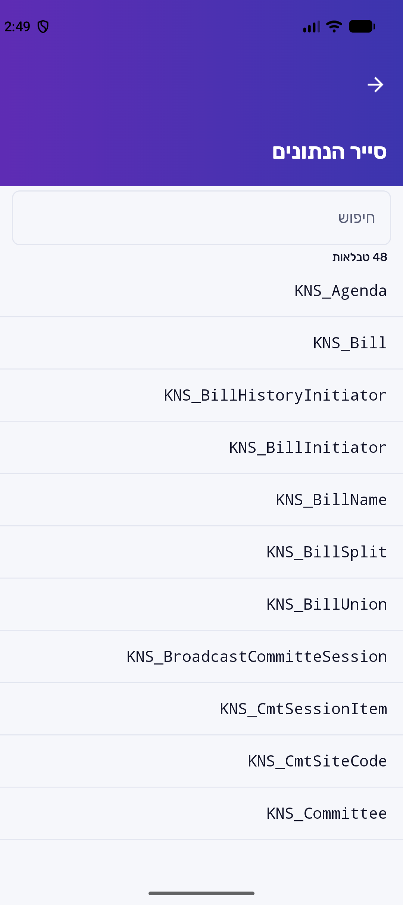

# Knesset

An Android app for browsing the Knesset open data: bills and laws, plenum votes and sittings, committees and their session calendar, members, factions and ministries. Hebrew first and right to left, with an English interface option. Read only, no account, no tracking.

Built with Kotlin Multiplatform and Compose Multiplatform. All logic and UI live in common code, so an iOS target can be added later. The design and the API research are in [docs/PLAN.md](docs/PLAN.md).

<p>







</p>

## Install on a phone

1. On the phone, open the latest release on GitHub (Releases on the repository page) and download the `knesset-vX.Y.Z.apk` file.
2. Open the downloaded file. Android asks to allow installs from the browser the first time: allow it for that browser.
3. Install. Later releases install over the old one, because every release is signed with the same key.

Without a release, every CI run attaches a debug APK as a workflow artifact (Actions, then the run, then `knesset-debug-apk`). It installs the same way.

The data comes from `knesset.gov.il`, which may refuse requests from outside Israel. Abroad the app shows a "not reachable from this location" message.

## Build

Requirements: JDK 17 or newer and the Android SDK (set `ANDROID_HOME`, or keep it at `~/Library/Android/sdk`).

```bash
./gradlew :composeApp:testDebugUnitTest :composeApp:assembleDebug
```

The APK is written to `composeApp/build/outputs/apk/debug/composeApp-debug.apk`. With a phone connected over USB (or wireless) debugging:

```bash
adb install -r composeApp/build/outputs/apk/debug/composeApp-debug.apk
```

Unit tests never call the live API. They use Ktor `MockEngine` with JSON fixtures captured from the live service, in `composeApp/src/commonTest/resources/fixtures/`.

## Releases

The workflow in `.github/workflows/android.yml` runs the tests and builds a debug APK on every push and pull request. Pushing a tag such as `v1.0.0` also builds a release APK signed with the release key and attaches it to a GitHub Release.

One-time setup by the repository owner:

1. Create a release keystore and keep it somewhere safe. Losing it means users must uninstall before they can install a new version.
   ```bash
   keytool -genkeypair -v -keystore knesset-release.jks -alias knesset -keyalg RSA -keysize 4096 -validity 10000
   ```
2. Add four repository secrets (Settings, Secrets and variables, Actions): `KEYSTORE_BASE64` (the output of `base64 -i knesset-release.jks`), `KEYSTORE_PASSWORD`, `KEY_ALIAS`, `KEY_PASSWORD`.
3. Tag and push:
   ```bash
   git tag v1.0.0 && git push origin v1.0.0
   ```

`composeApp/knesset-shared.jks` is a debug key only, checked in so that debug APKs from any machine or CI run install over each other. It never signs a release.

## Data

All data is from the Knesset OData v4 service at `https://knesset.gov.il/OdataV4/ParliamentInfo/`, shown as published, in Hebrew. The app caches responses on the device and works offline with what it has already seen. Lobbyist identity numbers are never requested or shown.
